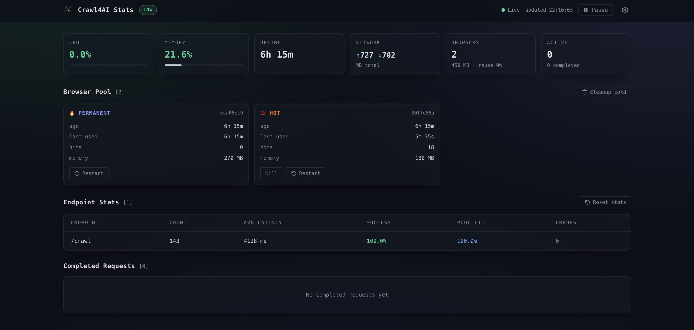

# 🕷️ Crawl4AI Stats

Real-time monitoring dashboard for self-hosted [Crawl4AI](https://github.com/unclecode/crawl4ai) servers (v0.9.x).

 

    



## What it does

Crawl4AI Stats polls your server's `/monitor/*` API endpoints and displays:

- **System health** — CPU, memory, uptime, network usage, memory pressure
- **Browser pool** — permanent, hot, and cold browsers with age, hits, memory, and kill/restart controls
- **Endpoint statistics** — request count, average latency, success rate, pool hit rate per endpoint
- **Active requests** — live view with elapsed time counter
- **Completed requests** — status, URL, elapsed time, memory delta, pool hit indicator
- **Error log** — recent errors with timestamp, endpoint, and error message
- **Actions** — force cleanup cold browsers, kill/restart individual browsers, reset endpoint statistics

All connection details (server URL and API token) are stored in your browser's localStorage. Nothing is sent to any third party.

## Requirements

- A self-hosted Crawl4AI server running **v0.9.x** with the monitor API enabled (enabled by default)
- Node.js 18+ (used for the built-in proxy server)

No CORS configuration is needed on your Crawl4AI server. The dashboard includes a lightweight Node.js proxy that makes all API requests server-side, avoiding browser CORS restrictions entirely.

## Configuring your Crawl4AI server's API token

Crawl4AI Stats doesn't issue or manage the API token — it just stores whatever token you give it in the settings panel and sends it as `Authorization: Bearer …`. The token itself is configured on **your Crawl4AI server**, via the `CRAWL4AI_API_TOKEN` environment variable. Since 0.9.x, Crawl4AI binds to loopback only until a token is set, so you need to set this before Crawl4AI Stats (or anything else) can reach it from outside the host.

Generate a token:

```bash
openssl rand -hex 32
```

Then set `CRAWL4AI_API_TOKEN` to that value on whichever platform runs Crawl4AI:

**Coolify** — New Resource → Docker Image → image `unclecode/crawl4ai:latest`, port `11235` → open the **Environment Variables** tab and add `CRAWL4AI_API_TOKEN` with the generated value, marking it as a secret if that option is available → Deploy. Keep Coolify itself up to date — older versions had bugs ([#7019](https://github.com/coollabsio/coolify/issues/7019), [#7235](https://github.com/coollabsio/coolify/issues/7235)) where secret env vars leaked into deployment logs.

**Docker Compose**

```yaml
services:
  crawl4ai:
    image: unclecode/crawl4ai:latest
    ports:
      - "11235:11235"
    environment:
      - CRAWL4AI_API_TOKEN=${CRAWL4AI_API_TOKEN}
    shm_size: 1g
```

```bash
echo "CRAWL4AI_API_TOKEN=$(openssl rand -hex 32)" >> .env
echo ".env" >> .gitignore
docker compose up -d
```

**Plain `docker run`**

```bash
CRAWL4AI_TOKEN="$(openssl rand -hex 32)"
docker run -d \
  --name crawl4ai \
  -p 11235:11235 \
  -e CRAWL4AI_API_TOKEN="$CRAWL4AI_TOKEN" \
  --shm-size=1g \
  unclecode/crawl4ai:latest
echo "Save this token: $CRAWL4AI_TOKEN"
```

Generating the token into a variable first, rather than inlining `$(openssl rand -hex 32)` directly in the `-e` flag, keeps the literal secret out of your shell history.

Once the server is running with a token, paste its URL and that token into Crawl4AI Stats' settings panel. See the [Crawl4AI self-hosting guide](https://docs.crawl4ai.com/core/self-hosting/) for the full reference.

> **Note:** all three approaches store the token as a plain container environment variable. Anyone with Docker access on that host can still read it via `docker inspect` (or `/proc/<pid>/environ`) — that's an inherent property of env-var-based config, not something these examples get wrong. Fine for a typical single-host self-hosted setup; if you need stronger isolation, look into Docker secrets (Swarm) or an external secrets manager instead.

## Quick start

```bash
git clone https://github.com/promptagency/crawl4ai-stats.git
cd crawl4ai-stats
npm install
npm run dev
```

Open `http://localhost:5173`, click the settings icon, enter your Crawl4AI server URL and API token, and hit **Test connection**.

## Deploying

Build and start the production server:

```bash
npm run build
npm start
```

The server runs on port 3001 by default (override with `PORT` env var). It serves the static dashboard and proxies API requests to your Crawl4AI server. Put it behind Nginx, Caddy, or any reverse proxy for HTTPS.

### Docker

```dockerfile
FROM node:22-alpine AS build
WORKDIR /app
COPY package*.json ./
RUN npm ci
COPY . .
RUN npm run build

FROM node:22-alpine
WORKDIR /app
COPY --from=build /app/dist ./dist
COPY --from=build /app/server.js .
COPY --from=build /app/proxy.js .
COPY --from=build /app/package.json .
EXPOSE 3001
CMD ["node", "server.js", "--production"]
```

### Cloudflare Workers

`worker.js` runs the same proxy as `server.js` and serves `dist/` as static assets (config in `wrangler.jsonc`).

```bash
npx wrangler login
npm run cf:deploy
```

`wrangler.jsonc` disables the `*.workers.dev` and preview URLs, so the Worker is only reachable on a domain you add yourself: **Workers & Pages → crawl4ai-stats → Settings → Domains & Routes** (the zone must be on Cloudflare).

> **Lock it down.** `/api/proxy` will fetch any public URL for whoever calls it, and the dashboard itself has no login. Put the domain behind [Cloudflare Access](https://developers.cloudflare.com/cloudflare-one/applications/configure-apps/self-hosted-public-app/) (Zero Trust → Access → Applications → Self-hosted) with a policy that allows only your own email. The same applies to the Node server — put it behind an authenticating reverse proxy.
